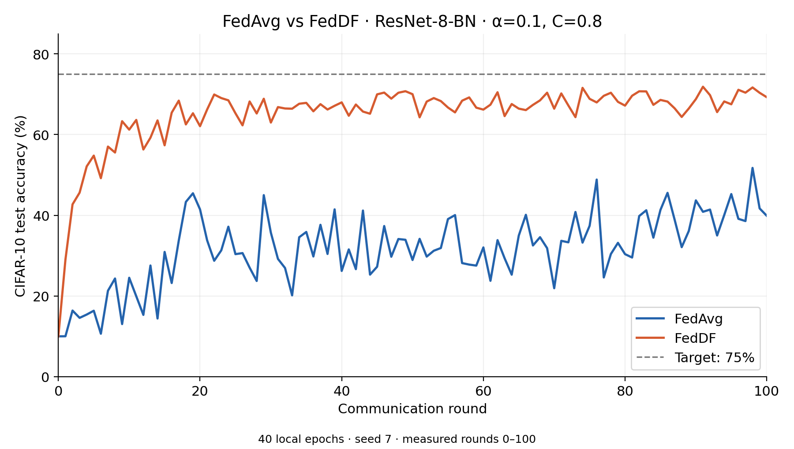

# FedDF with synchronous CollabAPI

This example extends the existing Collab FedAvg example with iterative
[FedDF](https://proceedings.neurips.cc/paper/2020/file/18df51b97ccd68128e994804f3eccc87-Paper.pdf).
It imports the standalone `DistillationTrainer` and `kl_divergence` helpers;
algorithm policy stays in the example.

Each round, clients train from the global model, and the server averages their
parameters to initialize a student. In FedDF mode, the server freezes the
current client models, computes their **mean logits** on unlabeled proxy images,
and distills that ensemble into the student. The resulting student is broadcast
for the next round. FedAvg mode broadcasts the average directly.

Both modes use uniform parameter averaging. Non-parameter buffers come from
the last client in sorted site order; the default `SimpleNetwork` has none.
The distillation optimizer is recreated each round. The default temperature is
1. No teacher history or synthesis is enabled.

## Installation

Follow the parent [installation instructions](../README.md#get-the-example-and-install-dependencies).
Run the commands below from `examples/advanced` in a source checkout, or from
the downloaded `collab-pt` directory, where the `collab` package is visible.

## Code structure

- `server.py`: synchronous workflow, uniform averaging and mean-logit ensemble.
- `distiller.py`: exportable factory binding optional backend settings.
- `job.py`: CLI, `CollabRecipe` wiring, simulation and export.
- `prepare_data.py`: disjoint client/proxy partitions.
- `../fedavg/client.py`, `../model.py`, `../loader.py`: shared training, model and data utilities.

## Data

```bash
python -m collab.pt_cifar10.feddf.prepare_data \
    --num-clients 8 --alpha 0.1 --proxy-size 5000 --seed 0
```

Preparation reserves 5,000 CIFAR-10 training images for the proxy and applies
Dirichlet partitioning to the remaining 45,000. The official 10,000-image test
set is evaluation-only. Proxy labels are discarded by the KD batch adapter.
Both modes use the same private shards; FedAvg leaves the proxy unused.
This supplied-proxy demonstration uses no data-free synthesis.

The new `/tmp/cifar10_splits/pt_cifar10_feddf` directory contains `proxy.npy`,
`site-N.npy` and `manifest.json` with class counts. Use `--alpha 0.01` and a new
`--split-root` for stronger skew. Preparation refuses to overwrite a directory.

## Model and client code

The runnable demonstration reuses `SimpleNetwork` and `FedAvgClient`.
`@collab.publish` exposes the client's `train` method for remote calls.
All clients participate in every round, using batch size 64, SGD learning rate
0.01, momentum 0.9 and one local epoch. Their optimizers and loaders persist.
Both modes share initialization, per-client seeds and prepared private data.
A dedicated proxy loader generator controls server input order.

## Server-side workflow

`@collab.main` marks the server entry point. Its `collab.clients(...).train(...)`
call invokes the published client method and waits for successful replies plus
failures. The server rejects incomplete rounds before fusion.

`MeanLogitEnsemble` wraps current-round teachers as **one** teacher for the
selected distiller. This makes its loss KL against mean logits, rather than the
mean of separate teacher KL losses. Each built-in distiller copies, freezes and
puts that ensemble in evaluation mode while training the averaged student.
The server calls only `fit()`, `export_student_state()` and `close()`, with
cleanup in `finally`. It loads the exported student state before evaluation and
broadcast, so a backend can own its wrapped/copied student. `FedDFServer` accepts
an exportable callable `distiller_factory`; `Cifar10DistillerFactory` binds the
backend configuration and keeps external internals out of the round loop.
The server then evaluates the student and uses it for the next round.

## Job recipe and run

`CollabRecipe` wires the server and existing FedAvg client; `SimEnv` executes
ordinary synchronous rounds locally.

```bash
python -m collab.pt_cifar10.feddf.job \
    --aggregation fedavg --num-clients 8 --num-rounds 20 --seed 10 \
    --workspace-root /tmp/nvflare/feddf-fedavg

python -m collab.pt_cifar10.feddf.job \
    --aggregation feddf --num-clients 8 --num-rounds 20 --seed 10 \
    --kd-epochs 1 --kd-lr 0.001 --temperature 1.0 \
    --workspace-root /tmp/nvflare/feddf
```

Pass the same `--split-root` to both commands for a custom split. FedDF uses
extra proxy data and server compute; improved accuracy is not guaranteed.
This compact demonstration differs from the reference experiment below in
model, partition, participation, local training and server stopping policy.
These commands do not reproduce the published curves.

## Optional distillation backends

The native implementation remains the default and requires neither external
library. To try a selected backend, install it in the same NVFlare environment:

```bash
python -m pip install nvidia-modelopt==0.48.0
python -m collab.pt_cifar10.feddf.job --aggregation feddf --distiller modelopt
```

Alternatively, install `torchdistill==1.1.5` and pass `--distiller torchdistill`.
The factory explicitly preserves mean-logit targets, pure KD, temperature-squared
scaling, batchmean reduction and Adam settings. Each proxy batch is one optimizer
update; accumulation is unsupported. Optional packages load only when selected.
Backend optimizers/checkpoint formats are not portable through this interface.
Synthesis and FedRevive's specialized per-teacher policy remain separate.
These backends have bounded CPU/numerical qualification, not a new full CIFAR
accuracy reproduction; the reference curves below are unchanged.

## Outputs

The server run directory contains `run_config.json`, per-round `metrics.json`
(accuracy, clients, local steps, aggregation time and KD loss/steps/samples),
and CPU `initial_model.pt`/`final_model.pt` state dictionaries. These support
comparison and inference, without resuming client optimizer/loader state or a
distributed workflow.

## FedDF reference validation

The following experiment validates the same standalone `DistillationTrainer`
using a separate FedDF composition: initialize the student from averaged
current-round client parameters, distill the mean teacher logits with KL loss,
and broadcast the fused student in the next round. The runnable example above uses the same averaging/mean-logit distillation
composition, with a smaller model and a shorter demonstration configuration.



| Method | Round 100 test accuracy | Best test accuracy in rounds 0–100 |
| --- | ---: | ---: |
| FedAvg | 39.88% | 51.74% |
| FedDF | 69.28% | 71.87% |

This single-seed run uses the original FP32 ResNet-8-BN (78,042 parameters),
CIFAR-10 with Dirichlet alpha 0.1, 16 of 20 clients per round, and 40 local epochs.
The private/validation split contains 45,000/5,000 training images; evaluation
uses the official 10,000-image test set. Local SGD uses batch size 64, constant
learning rate 0.1, no momentum, and no weight decay. FedDF additionally uses
50,000 unlabeled CIFAR-100 training images as proxy inputs. Its server uses
Adam at 0.001, temperature-1 KL, and validation-based stopping and checkpoint
selection. Parameter averaging, BatchNorm buffers and mode-specific client
sampling follow the
[released FedDF code](https://github.com/epfml/federated-learning-public-code/tree/44dd5551071969eb354ee2ed091a9ba36c1d5b08/codes/FedDF-code).

Neither curve reaches the 75% target within these 100 rounds. The
[paper's Table 1](https://proceedings.neurips.cc/paper/2020/file/18df51b97ccd68128e994804f3eccc87-Paper.pdf)
uses tuned local learning rates whose selected value for this setting is not
specified in the release; this run uses the README's 0.1. These measured curves
demonstrate the component's iterative FedDF composition and do not establish
the paper's reported target-round counts or three-seed statistics.

The [per-round data](figures/fedavg_vs_feddf_0_100.csv) and
[run configuration and qualifications](figures/feddf_reference_run.json)
accompany the figure.

## Export

Export without downloading data or starting the simulator:

```bash
python -m collab.pt_cifar10.feddf.job \
    --aggregation feddf --export --export-dir /tmp/feddf-jobs
```
