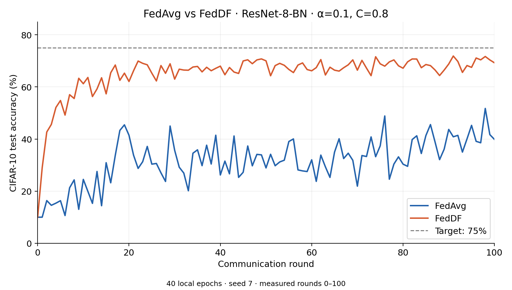

# Synchronous federated learning with KD aggregation

This example imports `DistillationTrainer` and `kl_divergence` to replace
server-side parameter averaging with knowledge distillation. It uses ordinary
synchronous `CollabRecipe` rounds and the existing FedAvg client, model and
evaluation code. No async recipe, FedRevive implementation or synthesis package
is needed.

Each round:

1. Every client trains from the same global model on its private shard.
2. The server waits for all replies and freezes the returned models as teachers.
3. A student starts from the **previous global model**, without weight averaging.
4. The shared trainer updates that student on unlabeled server proxy images.
5. The server evaluates and broadcasts the distilled student in the next round.

The trainer minimizes the **mean per-teacher KL loss**, with equal teacher
weights and aligned CIFAR-10 class outputs. It does not average teacher logits.
This is an illustrative distillation aggregation algorithm, not a reproduction
of a named paper. Teachers come only from the current round; no history buffer
or staleness policy is needed. The student optimizer is recreated each round.

## Prepare strongly heterogeneous data

Follow the parent [installation instructions](../README.md#get-the-example-and-install-dependencies).
Run these commands from `examples/advanced` in a source checkout, or from the
downloaded `collab-pt` directory, where the `collab` package is visible:

```bash
python -m collab.pt_cifar10.fedkd.prepare_data \
    --num-clients 8 --alpha 0.1 --proxy-size 5000 --seed 0
```

Preparation first reserves 5,000 random images from CIFAR-10's **training set**
for the server. It then applies the existing Dirichlet splitter to the other
45,000 training images. Each image belongs to exactly one client or the proxy
set. The official 10,000-image test set is used exclusively for evaluation.
Proxy labels appear in the preparation summary but are discarded by the KD
batch adapter; they never enter its loss.

The output is a new `/tmp/cifar10_splits/pt_cifar10_fedkd` directory containing
`proxy.npy`, `site-N.npy` and `manifest.json`, including class counts. Both
aggregation modes use these same private shards. The FedAvg baseline leaves
the proxy data unused. This models an available unlabeled public/proxy dataset;
it is not a data-free experiment.

Use `--alpha 0.01` with a different `--split-root` for more extreme label skew.
Inspect the manifest's actual client class counts: alpha describes a sampling
distribution, not a fixed number of classes per client. Preparation requires a
new output directory so an existing experiment's shards cannot be overwritten.

## Compare aggregation methods

```bash
python -m collab.pt_cifar10.fedkd.job \
    --aggregation fedavg --num-clients 8 --num-rounds 20 --seed 10 \
    --workspace-root /tmp/nvflare/fedkd-fedavg

python -m collab.pt_cifar10.fedkd.job \
    --aggregation kd --num-clients 8 --num-rounds 20 --seed 10 \
    --kd-epochs 1 --kd-lr 0.001 --temperature 2.0 \
    --workspace-root /tmp/nvflare/fedkd-kd
```

Use the same `--split-root` for both commands if you prepared a custom split.
Every round includes all clients. Model initialization, per-site training seeds,
private sample order, local SGD/momentum, batch size 64, learning rate 0.01 and
one local epoch are identical between modes. Client optimizers and loaders
persist across rounds, as in the existing FedAvg example. A dedicated proxy
loader generator prevents server teacher construction from shifting proxy order.
Seeds support controlled comparisons; cross-device bitwise equality is not
guaranteed.

The FedAvg mode uses the existing **local-step-weighted parameter average**.
KD uses **equally weighted teacher losses**; these weighting choices are
explicitly different when shard sizes differ. KD also uses additional server
data and compute. Compare test accuracy by round together with aggregation
cost; improved accuracy on extreme heterogeneity is an experimental question,
not a guaranteed outcome. The default 20 rounds are a starting example, not a
qualified convergence budget.

All models share one architecture and class ordering. This keeps the comparison
focused on data heterogeneity. The standalone trainer supports different
teacher/student architectures, but broadcasting one global state into every
client in this example assumes compatible architectures.

## Reuse and outputs

The server's `aggregate()` method supplies ordinary inputs, teachers and an
optimizer factory to the installed KD helper:

```python
trainer = DistillationTrainer(
    student=model,
    teachers=teacher_factories,
    optimizer_factory=partial(torch.optim.Adam, lr=kd_lr),
    device=device,
    batch_adapter=lambda batch: batch[0],
    loss_fn=partial(kl_divergence, temperature=temperature),
)
metrics = trainer.fit(proxy_loader)
```

To supply different public inputs, replace the loader and batch adapter. An
optional future data-free variant can supply batches from the shared synthetic
pool while retaining the same trainer; this example intentionally starts with
supplied data.

The server run directory contains:

- `run_config.json`: resolved composition, split manifest, seeds and training settings.
- `metrics.json`: per-round test accuracy, client identities/local steps,
  aggregation time and, for KD, loss/steps/samples.
- `initial_model.pt` and `final_model.pt`: CPU state dictionaries.

These model artifacts support comparison and inference. They do not restore
client optimizer/loader state or resume a distributed experiment.

## FedDF reference validation

The following experiment validates the same standalone `DistillationTrainer`
using a separate FedDF composition: initialize the student from averaged
current-round client parameters, distill the mean teacher logits with KL loss,
and broadcast the fused student in the next round. The default example above
uses its own illustrative aggregation rule and training configuration.



| Method | Round 100 test accuracy | Best test accuracy in rounds 0–100 |
| --- | ---: | ---: |
| FedAvg | 39.88% | 51.74% |
| FedDF | 69.28% | 71.87% |

This single-seed run uses the original FP32 ResNet-8-BN (78,042 parameters),
CIFAR-10 with Dirichlet alpha 0.1, 16 of 20 clients per round, and 40 local epochs.
The private/validation split contains 45,000/5,000 training images; evaluation
uses the official 10,000-image test set. Local SGD uses batch size 64, constant
learning rate 0.1, no momentum, and no weight decay. FedDF additionally uses
50,000 unlabeled CIFAR-100 training images as proxy inputs. Its server uses
Adam at 0.001, temperature-1 KL, and validation-based stopping and checkpoint
selection. Parameter averaging, BatchNorm buffers and mode-specific client
sampling follow the
[released FedDF code](https://github.com/epfml/federated-learning-public-code/tree/44dd5551071969eb354ee2ed091a9ba36c1d5b08/codes/FedDF-code).

Neither curve reaches the 75% target within these 100 rounds. The
[paper's Table 1](https://proceedings.neurips.cc/paper/2020/file/18df51b97ccd68128e994804f3eccc87-Paper.pdf)
uses tuned local learning rates whose selected value for this setting is not
specified in the release; this run uses the README's 0.1. These measured curves
demonstrate the component's iterative FedDF composition and do not establish
the paper's reported target-round counts or three-seed statistics.

The [per-round data](figures/fedavg_vs_feddf_0_100.csv) and
[run configuration and qualifications](figures/feddf_reference_run.json)
accompany the figure.

## Export

Export either mode without downloading data or starting the simulator:

```bash
python -m collab.pt_cifar10.fedkd.job --aggregation kd --export --export-dir /tmp/fedkd-jobs
```

The recipe packages the example's Python dependencies; it imports distillation
from the installed NVFlare package. Exported jobs require CIFAR-10 under
`/tmp/cifar10` and the prepared indices at the configured path on the relevant
sites (proxy/manifest on the server, each private shard on its client). Local
`SimEnv` processes share those paths. Distributed execution and CUDA accuracy
are separate qualification tasks.

The independent async/FedBuff consumer is already provided by
[the async CIFAR-10 example](../../pt_async_cifar10/README.md).
